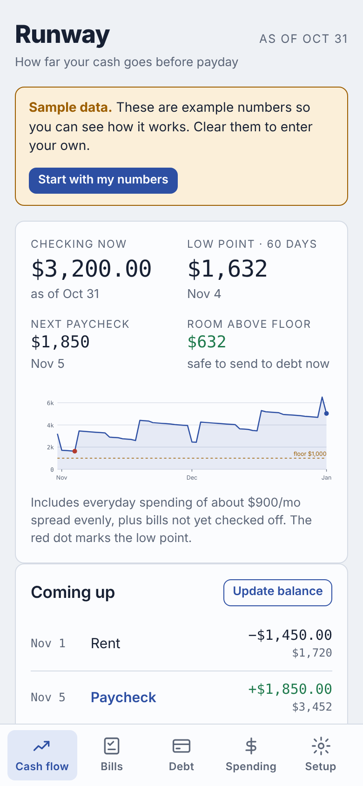
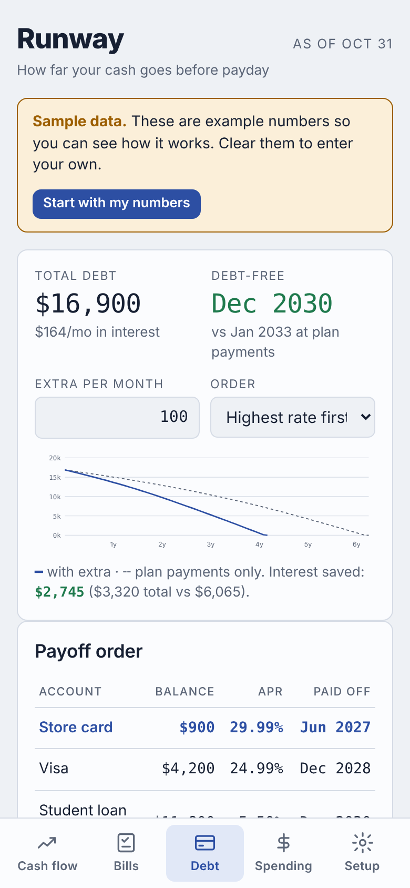
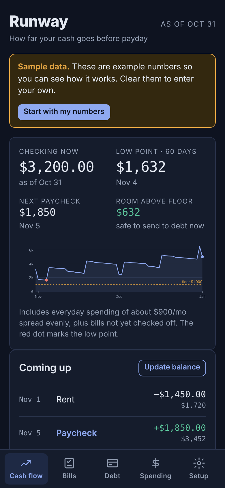

# Runway

**How far your cash goes before payday.** [Try it live](https://dualityframework-ux.github.io/Runway/) · [Read the case study](https://dualityframework-ux.github.io/Runway/case-study.html)

Runway is a mobile-first cash-flow and debt payoff planner. Most budgeting apps tell you where your money went. Runway tells you where it's headed: the lowest your checking account will dip over the next 60 days, how much you can safely send to debt today, and when you'll be debt-free.

  
  
  

## Features

- **60-day cash-flow forecast.** Projects your checking balance day by day from paychecks, dated bills and everyday spending, and flags the low point.
- **Safety floor.** Set a minimum balance you never want to drop below. Runway shows the room above it, which is the amount you can put toward debt without risking an overdraft.
- **Bill checklist.** Check off bills as you pay them each month. Paid bills drop out of the forecast automatically. Bills can be monthly, every 3 or 6 months, yearly or one-time, and only show up in the months they're due.
- **Debt payoff simulator.** Compares avalanche (highest APR first) and snowball (smallest balance first), shows the debt-free date with and without an extra monthly payment, and calculates the interest saved. Supports promo rates with an end date: the rate switches on schedule, and it warns how much will still be owed when the promo ends.
- **Spending log.** Log purchases by category and track them against a monthly budget. Import a bank statement CSV: it detects the columns (including separate debit and credit columns), guesses categories from merchant names, skips deposits and duplicates, and shows a preview to correct before anything is added. Corrections are remembered for future imports.
- **Private by design.** No account, no bank login, no server. Data is saved in the browser on your own device, with a copy-and-paste backup to move it to another device.
- **Works like an app.** Bottom tab navigation, light and dark themes, and an icon for adding it to a phone's home screen.

## How the forecast works

1. Start from the current checking balance and its as-of date.
2. Lay out every scheduled event in the next 62 days:
   - each bill on its due day, clamped to the last day of shorter months, skipping bills already marked paid for that month;
   - each paycheck, stepping forward from the next payday by the pay interval (14 days for biweekly);
   - any one-time income.
3. Spread the monthly spending budget evenly across days (`monthly × 12 ÷ 365`) and subtract it daily, so the line reflects groceries and gas between bills.
4. Walk the calendar one day at a time, apply that day's events, and record the running balance. The minimum of that series is the **low point**, and `low point − floor` is the **room above floor**.

## How the debt simulator works

Each month:

1. Accrue interest on every balance at `APR ÷ 12`.
2. Pay each account's minimum payment.
3. Pool the extra payment plus any minimums freed up by accounts already paid off (the rollover, or snowball effect).
4. Apply the pool to accounts in priority order: highest APR first for avalanche, smallest balance first for snowball.

The simulation runs twice, once with the extra payment and once with minimums only, so the app can show the time and interest an extra payment saves.

## Tech

- A single self-contained `index.html` file: vanilla JavaScript, HTML and CSS, with no framework and no build step.
- Charts are hand-built SVG, with no charting library.
- State is a single JSON object kept in `localStorage`. The page still works if storage is blocked, for example in a private window.
- Theme colors are CSS custom properties, with full light and dark palettes.

## Tests

`node tests/runway.test.js` runs 17 tests against the app's own code: the day-by-day forecast, short-month bills, bill frequencies, interest accrual, avalanche vs. snowball order, promo rate switches, and bank CSV import (both sign conventions, debit/credit columns, duplicates, learned categories). They load the script straight from `index.html` in a minimal fake browser, so the tests check exactly what ships. GitHub Actions runs them on every push.

## Run it

Open `index.html` in any modern browser. To host it, enable GitHub Pages on this repo and it will be served as a static site. On a phone, open it in the browser and choose **Add to Home Screen**.

## Roadmap

- Native iOS and Android app

## About

Built by **Ian Kachadorian**, a finance and data professional with a background in investment accounting and inventory analytics. Runway grew out of a personal cash-flow tracker I built for myself and then generalized so anyone can use it.

## License

MIT — see [LICENSE](LICENSE).
